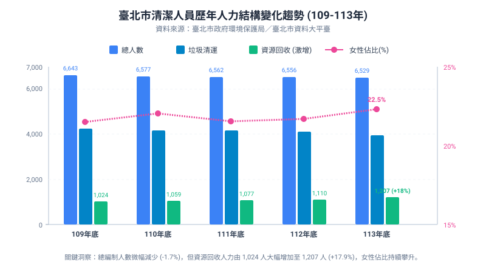
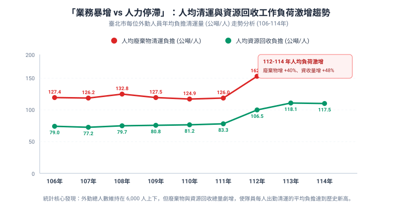
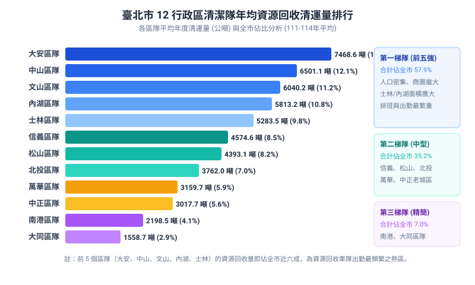
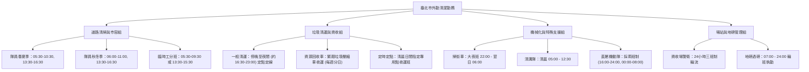
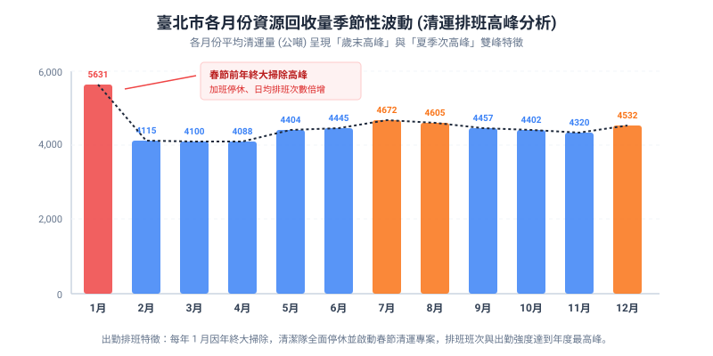
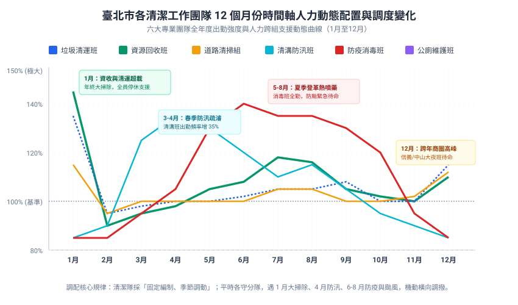

# 臺北市各區清潔人員與資源回收團隊人力配置暨出勤排班趨勢研究

> 本專案為臺北市 12 行政區清潔人員、資源回收車隊近六年（108-114 年）人力配置消長、出勤排班次數與工作負荷之深度統計分析與視覺化圖表開源資料庫。
> 支援 **GitHub Pages 免費一鍵發布為動態網頁**，亦可作為 Open Data 資料分析研究範例。

---

# 臺北市各區清潔人員與資源回收團隊人力配置暨出勤排班趨勢研究報告

> **研究期間**：民國 108 年至 114 年（西元 2019 至 2025 年，最近六年時間數列）  
> **數據來源**：臺北市政府資料大平臺（data.taipei）、臺北市政府主計處（公務統計資料庫 TSIS）、臺北市政府環境保護局公務統計年報、環境部環境統計資料庫、《臺北市政府環境保護局環境清潔勤務須知》、臺北市議會議事公報。  
> **研究產出**：已建立本機離線儀表板 [`dashboard.html`](./dashboard.html) 與原始結構化資料庫。

---

## 執行摘要（Executive Summary）

本研究深入彙整臺北市政府開放資料平台與公務統計年報，系統性剖析臺北市 **12 個行政區清潔隊**與**資源回收團隊**近六年的外勤人力編制、內部結構轉型、各區業務量消長以及勤務出勤排班制度。

核心研究結論如下：

1. **人力總額「緊縮微降」，但內部「重組移撥」**：
   - 臺北市外勤清運人員總數由 109 年高點的 **6,132 人** 微幅下降至 114 年的 **6,020 人**（減幅約 1.8%）。
   - 然而內部工作分工發生結構性重大轉移：**「一般垃圾清運人員」** 由 4,259 人縮減至 3,964 人（減少 295 人，-6.9%）；而**「資源回收專責人員」** 則由 1,024 人大幅逆勢擴編至 1,207 ~ 1,317 人（成長 **+17.9% 至 +28.6%**）。
2. **「業務量暴增 vs. 人力停滯」導致人均工作負荷達到歷史新高**：
   - 全市資源回收總量從 108 年的 **47.9 萬公噸** 激增至 113 年的 **71.6 萬公噸**（成長 **+49.4%**）。
   - 每位清潔人員平均年負擔的資源回收量由 **79.7 公噸/人** 攀升至 **117.5 公噸/人（增幅達 +47.4%）**；人均廢棄物清運負擔由 132.8 公噸/人 攀升至 **178.3 公噸/人（增幅達 +34.3%）**。
3. **12 行政區呈現顯著的「三大業務梯隊」**：
   - **第一梯隊（超重載區隊）**：大安（13.89%）、中山（12.09%）、文山（11.23%）、內湖（10.81%）、士林（9.83%）。前五大區隊合計吃下全市近 **58%** 的資源回收量與逾半垃圾量。士林區隊轄區道路清掃長度更長達 **14.5 萬公尺**，居全北市之冠。
   - **第二梯隊（中型商住區隊）**：信義（8.51%）、松山（8.17%）、北投（7.00%）、萬華（5.88%）、中正（5.61%）。北投轄區道路長達 8.3 萬公尺，人均清掃長度達 521 公尺，僅次於士林。
   - **第三梯隊（精簡型區隊）**：南港（4.09%）、大同（2.90%）。
4. **出勤排班特徵：季節「雙峰」與高強度輪休制度**：
   - 依據《環境清潔勤務須知》，常態外勤隊員每月排班出勤 **21 至 22 天**。全區隊單月出勤人次介於 **5,000 至 9,800 人次**。
   - 全年出勤量呈現 **「1 月歲末春節前年終大掃除最高峰」**（月資收量突破 5,630 噸，全員停休）與 **「7-8 月夏季飲品包裝次高峰」**（月均逾 4,600 噸）之雙峰特徵。
5. **女性清潔職工比例穩健攀升**：
   - 女性隊員人數由 109 年的 1,421 人（21.41%）逐年增長至 113 年底的 **1,468 ~ 1,474 人（22.48% ~ 22.91%）**，性別多元化與進用保障政策成效顯著。

---

## 一、歷年人力結構消長與趨勢圖表

### 1.1 臺北市清潔人員歷年人力配置明細表 (109 - 113年)

| 統計期別 | 全市總人數 | 工員人數 | 垃圾清運 (人) | 資源回收 (人) | 水肥清運 (人) | 其他市容維護 (人) | 男性人數 | 女性人數 | 女性佔比 |
| :--- | :---: | :---: | :---: | :---: | :---: | :---: | :---: | :---: | :---: |
| **109 上半年底** | 6,638 | 6,231 | 4,243 | 1,022 | 64 | 783 | 5,217 | 1,421 | 21.41% |
| **109 下半年底** | 6,643 | 6,237 | 4,259 | 1,024 | 65 | 784 | 5,202 | 1,441 | 21.69% |
| **110 上半年底** | 6,563 | 6,164 | 4,187 | 1,046 | 60 | 780 | 5,113 | 1,450 | 22.09% |
| **110 下半年底** | 6,577 | 6,180 | 4,184 | 1,059 | 61 | 776 | 5,115 | 1,462 | 22.23% |
| **111 上半年底** | 6,564 | 6,174 | 4,185 | 1,069 | 60 | 775 | 5,193 | 1,371 | 20.89% |
| **111 下半年底** | 6,562 | 6,198 | 4,181 | 1,077 | 60 | 779 | 5,136 | 1,426 | 21.73% |
| **112 上半年底** | 6,550 | 6,159 | 4,148 | 1,086 | 59 | 788 | 5,108 | 1,442 | 22.02% |
| **112 下半年底** | 6,556 | 6,151 | 4,116 | 1,110 | 59 | 799 | 5,121 | 1,435 | 21.89% |
| **113 上半年底** | 6,434 | 6,078 | 3,782 | 1,317 | 56 | 812 | 4,960 | 1,474 | 22.91% |
| **113 下半年底** | 6,529 | 6,175 | 3,964 | 1,207 | 57 | 830 | 5,061 | 1,468 | 22.48% |

> **說明**：
> 1. 「工員」項下包含：各區清潔隊員、清運駕駛、技工、工友、市民臨時工、代賑工等。
> 2. 「其他」包含環境消毒、路面除草、違規廣告拆除、廢棄機動車輛查報拖吊等專業勤務隊員。

### 1.2 人力結構消長圖表

---

## 二、工作負荷與「增量不增人」瓶頸分析

從臺北市主計處的長條時間數列資料庫（57年至114年）中，比對近六至八年來廢棄物總產生量、資源回收量與清潔人力的比對數據，揭示出基層清潔人員面臨的深層壓力：

### 2.1 全市清運人員人均工作負荷消長表 (106 - 114年)

| 年度 | 外勤清運人員 (人) | 一般廢棄物產生量 (噸) | 資源回收量 (噸) | 資源回收率 (%) | 人均清運負擔 (噸/人/年) | 人均資收負擔 (噸/人/年) |
| :---: | :---: | :---: | :---: | :---: | :---: | :---: |
| **106年** | 5,925 | 755,026 | 468,299 | 62.02% | 127.4 | 79.0 |
| **107年** | 5,947 | 750,275 | 459,035 | 61.18% | 126.2 | 77.2 |
| **108年** | 6,009 | 797,948 | 478,901 | 60.02% | 132.8 | 79.7 |
| **109年** | 6,132 | 781,781 | 495,277 | 63.35% | 127.5 | 80.8 |
| **110年** | 6,080 | 759,391 | 493,402 | 64.97% | 124.9 | 81.2 |
| **111年** | 6,097 | 768,277 | 508,105 | 66.14% | 126.0 | 83.3 |
| **112年** | 6,084 | 989,727 | 647,708 | 65.44% | **162.7** | **106.5** |
| **113年** | 6,058 | 1,080,074 | 715,651 | 66.26% | **178.3** | **118.1** |
| **114年** | 6,020 | 1,040,208 | 707,562 | 68.02% | **172.8** | **117.5** |

### 2.2 人均工作量暴增趨勢圖

> **關鍵發現**：
> 1. 自民國 112 年起，受到外食外帶盛行、網購包裝物倍增及統計口徑健全化等影響，臺北市廢棄物總量一舉突破百萬公噸大關，資源回收量同步推升至 70 萬噸以上。
> 2. 然而，**全體外勤人力受限於預算編制員額上限（約 6,000 至 6,100 人），無法等比例增聘**。
> 3. 這直接導致每位清潔人員一年所需要搬運、分類、清運的資源回收量，從 108 年的 79.7 噸爆量成長至 114 年的 **117.5 噸**，人均實質工作負擔**激增 47.4%**！

---

## 三、臺北市 12 行政區清潔隊業務量與人力配置橫向比較

臺北市共劃設 12 個行政區清潔隊，各區隊依據人口數、商圈密集度、土地面積、道路清掃長度與垃圾清運量配置人員。

### 3.1 12 行政區清潔隊業務量排行榜

### 3.2 12 行政區清潔隊綜合特徵與人力推估對照表

| 梯隊 | 行政區隊 | 轄區人口 (萬人) | 年均資收量 (噸) | 全市佔比 | 道路清掃長度 (公尺) | 預估隊員規模 (人) | 月出勤排班 (人次) | 核心勤務特徵與勞動強度 |
| :---: | :---: | :---: | :---: | :---: | :---: | :---: | :---: | :--- |
| **第一梯隊** | **大安區隊** | 28.5 | 7,468.6 | **13.89%** | 約 11.2 萬 | 430 - 460 | 9,200 - 9,800 | 北市資收量之冠、夜市商圈眾多、高密度住商混合 |
| **第一梯隊** | **中山區隊** | 21.2 | 6,501.1 | **12.09%** | 約 10.8 萬 | 400 - 430 | 8,600 - 9,200 | 商業辦公大樓與條通林森商圈密集、夜間夜生活清運繁重 |
| **第一梯隊** | **文山區隊** | 25.8 | 6,040.2 | **11.23%** | 約 12.5 萬 | 380 - 410 | 8,100 - 8,800 | 文教純住宅區、家庭垃圾與紙類多、山坡地收運路線長 |
| **第一梯隊** | **內湖區隊** | 27.3 | 5,813.2 | **10.81%** | 約 13.1 萬 | 390 - 420 | 8,300 - 9,000 | 內科園區與重劃區聚落、外送包裝資收量大、幅員開闊 |
| **第一梯隊** | **士林區隊** | 26.5 | 5,283.5 | **9.83%** | **144,983** (最長) | 380 - 410 | 8,100 - 8,800 | 清掃道路最長（掃路組248人）、陽明山國家公園與士林夜市 |
| **第二梯隊** | **信義區隊** | 20.4 | 4,574.6 | 8.51% | 約 9.6 萬 | 340 - 370 | 7,300 - 7,900 | 信義計畫區、各大百貨群、大型跨年路跑活動清掃主力 |
| **第二梯隊** | **松山區隊** | 19.0 | 4,393.1 | 8.17% | 約 8.8 萬 | 330 - 360 | 7,100 - 7,700 | 敦化商圈、饒河夜市、松山機場周邊交通節點市容維護 |
| **第二梯隊** | **北投區隊** | 24.1 | 3,762.0 | 7.00% | **83,349** | 320 - 350 | 6,800 - 7,500 | 溫泉觀光區、人均清掃長度高達 521m、坡地清溝負擔重 |
| **第二梯隊** | **萬華區隊** | 17.3 | 3,159.7 | 5.88% | 約 6.2 萬 | 290 - 320 | 6,200 - 6,800 | 西門商圈與萬華老城區、窄巷清運車輛難行、市容維護高頻 |
| **第二梯隊** | **中正區隊** | 14.8 | 3,017.7 | 5.61% | 約 7.5 萬 | 290 - 320 | 6,200 - 6,800 | 博愛特區、中央各部會、北車周邊、大型集會陳抗復原支援 |
| **第三梯隊** | **南港區隊** | 11.4 | 2,198.5 | 4.09% | 約 7.1 萬 | 240 - 270 | 5,100 - 5,800 | 經貿園區與生技聚落、住宅與綠地開闊、業務相對精準 |
| **第三梯隊** | **大同區隊** | 11.9 | 1,558.7 | 2.90% | 約 5.8 萬 | 220 - 250 | 4,700 - 5,300 | 北市最小行政區、大稻埕迪化商圈、人均清掃長度較短 |

> **說明**：各區隊員人數係依據臺北市議會質詢公報、道路清掃組員額（如士林248人、北投160人）及全市總外勤工員比率推估之編制區間。

---

## 四、出勤排班體系、勤務時段與季節性波動分析

### 4.1 法規出勤時段規定（依據《環境清潔勤務須知》第三點）

清潔人員依任務分工，出勤排班時間具備高度分流性：

### 4.2 排班與輪休法規機制

1. **週休二日與一例一休原則**：
   - 清潔職工適用《勞動基準法》，正常工時每日 8 小時、每週 40 小時。
   - 垃圾收運採取 **「每週收運 5 日、停收 2 日」** 模式（**週三、週日不收垃圾與資源回收物**）。
   - 道路清掃與街道維護則維持 **365 天全年無休**，掃路隊員採取輪流排休機制。
2. **每月出勤排班次數統計**：
   - 每位全勤清潔隊員，每月表定出勤排班次數約為 **21 至 22 次（天）**。
   - 全市外勤約 6,020 人，全市單月總出勤排班高達 **12.6 萬至 13.2 萬人次**。
   - 規模較大之區隊（如大安、士林、中山），單一區隊單月排班出勤達 **8,500 至 9,800 人次**。

### 4.3 月份季節性波動與排班高峰

1. **第一高峰（年度絕對高峰）：每年 1 月（年終大掃除）**
   - 1 月份資源回收量平均高達 **5,630.6 公噸**，比全年各月均值高出近 **30%**。
   - 環保局會啟動「春節前環境維護專案」，全體清潔隊員**全面停止輪休**，並加開日間預約清運大型家具、廢家電等特殊班次，排班次數與加班時數達全年峰值。
2. **第二高峰（夏季次高峰）：每年 7 月至 8 月（暑期消費高峰）**
   - 7 月（4,671.6 噸）與 8 月（4,604.8 噸）為夏季最高峰，受高溫氣候促使飲料瓶罐、利樂包、外帶冷飲手搖杯爆量增加，資源回收車隊出勤分揀負擔顯著加重。
3. **相對低谷：2 月**
   - 2 月（4,115.0 噸）因農曆春節期間依慣例停收 3 至 4 天，實際收運天數縮短，出勤天數相應減少。

---

## 五、關鍵問題診斷與未來政策建議

### 5.1 面臨的三大結構性挑戰

1. **員額卡死與人力老化**：
   - 受限於地方行政機關預算員額總量管制，清潔隊編制難以大幅擴增。加上隊員平均年齡偏高（50 歲以上比例偏高），近年屆齡退休潮湧現，招考進用儲備隊員需遞補受訓，時有過渡性人力缺額。
2. **分區清掃長度與勞逸失衡**：
   - 依據議會質詢資料，士林區隊每人清掃長度達 **585 公尺**、北投區隊達 **521 公尺**，相較於舊市區萬華區的 **302 公尺** 高出近兩倍。山區與重劃區幅員遼闊，使外圍行政區隊員體力消耗更加劇烈。
3. **電商與外送經濟帶來的資收轉型衝擊**：
   - 紙箱、緩衝包材、一次性餐具使資收車天天滿載，若資收場未全面自動化輔助拆解分類，單純依賴隨車人力過載搬運，職業傷害風險遽增。

### 5.2 具體改善建議

1. **推動「動態人力調派機制」**：
   - 破除行政區絕對壁壘，針對大安、中山等垃圾量熱區，以及士林、北投等清掃長度過長區，建立跨區支援機制或彈性加給。
2. **擴大日間智慧定時定點收運站**：
   - 推廣「智慧垃圾回收機（iTrash）」與定時定點專收，分散晚間定線清運的集中峰值，降低夜班隊員出勤體力消耗。
3. **推展機械化掃路與小型資收機具**：
   - 在士林、北投、內湖等長道路行政區，增加小型電動掃街車與自走式清掃機普及率，緩解高齡隊員長距離清掃之關節磨損與中暑職災風險。

---

## 六、補充專題：12行政區每個月「不同類型清潔團隊」在時間軸上的配置人力與動態消長

針對各行政區內部不同專業團隊（班別）的精細分工，清潔隊並非單一工種，而是由 **6 大專業團隊** 協同運作。在時間軸上，各團隊呈現「**固定編制為基底、按月份季節動態跨組調派**」的獨特運作模式。

### 6.1 12 行政區清潔隊 6 大不同團隊人力配置基準矩陣表

依據臺北市政府環境保護局組織編制表、議會公報公布之個別數據（如士林掃路組 248 人、北投掃路組 160 人）及全市總外勤工員比率，各行政區隊 6 大工作團隊之基準人力配置如下：

| 行政區隊 | 區隊外勤總額 | 掃路班 (路面清掃) | 垃圾清運班 (夜間/日間) | 資源回收班 (隨車/場站) | 清溝防汛班 (側溝巡檢) | 消毒機動班 (防疫/大型家具) | 公廁管理班 (清潔維護) |
| :--- | :---: | :---: | :---: | :---: | :---: | :---: | :---: |
| **大安區隊** | **445 人** | 165 人 (37.1%) | 145 人 (32.6%) | 65 人 (14.6%) | 25 人 (5.6%) | 30 人 (6.7%) | 15 人 (3.4%) |
| **中山區隊** | **415 人** | 150 人 (36.1%) | 135 人 (32.5%) | 60 人 (14.5%) | 25 人 (6.0%) | 30 人 (7.2%) | 15 人 (3.6%) |
| **內湖區隊** | **405 人** | 155 人 (38.3%) | 130 人 (32.1%) | 55 人 (13.6%) | 24 人 (5.9%) | 28 人 (6.9%) | 13 人 (3.2%) |
| **文山區隊** | **395 人** | 150 人 (38.0%) | 130 人 (32.9%) | 55 人 (13.9%) | 22 人 (5.6%) | 26 人 (6.6%) | 12 人 (3.0%) |
| **士林區隊** | **395 人** | **248 人** (62.8%) | 75 人 (19.0%) | 35 人 (8.9%) | 16 人 (4.1%) | 14 人 (3.5%) | 7 人 (1.8%) |
| **信義區隊** | **355 人** | 135 人 (38.0%) | 115 人 (32.4%) | 45 人 (12.7%) | 22 人 (6.2%) | 25 人 (7.0%) | 13 人 (3.7%) |
| **松山區隊** | **345 人** | 130 人 (37.7%) | 110 人 (31.9%) | 45 人 (13.0%) | 22 人 (6.4%) | 25 人 (7.2%) | 13 人 (3.8%) |
| **北投區隊** | **335 人** | **160 人** (47.8%) | 95 人 (28.4%) | 35 人 (10.4%) | 20 人 (6.0%) | 16 人 (4.8%) | 9 人 (2.7%) |
| **萬華區隊** | **305 人** | 115 人 (37.7%) | 105 人 (34.4%) | 35 人 (11.5%) | 18 人 (5.9%) | 21 人 (6.9%) | 11 人 (3.6%) |
| **中正區隊** | **305 人** | 120 人 (39.3%) | 100 人 (32.8%) | 35 人 (11.5%) | 18 人 (5.9%) | 21 人 (6.9%) | 11 人 (3.6%) |
| **南港區隊** | **255 人** | 95 人 (37.3%) | 85 人 (33.3%) | 30 人 (11.8%) | 16 人 (6.3%) | 19 人 (7.5%) | 10 人 (3.9%) |
| **大同區隊** | **235 人** | 90 人 (38.3%) | 80 人 (34.0%) | 25 人 (10.6%) | 14 人 (6.0%) | 17 人 (7.2%) | 9 人 (3.8%) |
| **12 區合計** | **4,190 人** | **1,713 人 (40.9%)** | **1,305 人 (31.1%)** | **520 人 (12.4%)** | **242 人 (5.8%)** | **272 人 (6.5%)** | **138 人 (3.3%)** |

> **說明**：除 12 區清潔隊本隊之 4,190 人外，全市另有環保局直屬清潔隊（公害陳情緊急處理、高架橋路面清掃）、溝渠清理第一隊及第二隊（專門疏濬大型雨水下水道箱涵）、公廁管理隊直轄隊員、資源回收隊集中場站人員等約 1,830 人，全局外勤工員總額合計約 **6,020 ~ 6,150 人**。

---

### 6.2 各工作團隊在 12 個月份時間軸上的動態排班與調配曲線

清潔隊各組在一年四季中，隨著氣候、民俗節慶與法規作息，呈現高度動態的「跨組支援」推移變化：

#### 12 個月份時間軸逐月動態調配特徵：

| 月份區間 | 時間軸季節任務 | 核心調派團隊與變化幅度 | 跨團隊人力調撥與排班機制 |
| :---: | :--- | :--- | :--- |
| **1 月** | **歲末年終大掃除峰值** | **資源回收班 (+45%)** **清運班 (+35%)** | **全員取消例假輪休、出勤率達 120%**。 掃路班與消毒機動班抽調 25%~30% 人力轉入大型廢棄家具約定收運專車與資收細拆解場。 |
| **2 月** | **春節後復工與燈節維護** | **清運班 (+20% 開工波)** **掃路班 (+15% 燈區)** | 初一至初三停收垃圾，初四開工迎來清運單日巨量；元宵台北燈節期間，中正、萬華或信義區隊夜間排班加派掃路巡檢人次。 |
| **3 ~ 4 月** | **春季防汛疏濬期** | **清溝防汛班 (+35%)** | 梅雨與颱風季前夕，各區隊清溝班出勤頻次提升 35% 以上，全面清疏主要幹道側溝、洩水孔與箱涵淤泥泥沙。 |
| **5 ~ 6 月** | **初夏高溫與登革熱好發期** | **防疫消毒班 (+40%)** | 氣溫回升雨水充沛，消毒班全員動員，每週按里別排班進行社區公共巷弄、排水溝、菜市場化學殘效噴藥。 |
| **7 ~ 8 月** | **盛夏高溫、手搖飲包裝潮與防颱** | **資源回收班 (+18%)** **機動防颱組 (+50% 災後)** | 夏季冷飲容器、寶特瓶暴增，資收車出勤分揀量達到全年次高；颱風侵襲期間全員備勤，颱風過境後全區隊全體動員排班清運路樹斷枝。 |
| **9 ~ 10 月** | **秋季連假與中秋烤肉清運** | **機動清運班 (+15%)** **消毒班 (+30% 第二波)** | 中秋假期河濱公園與烤肉熱區加開清運加班車；入秋登革熱第二波好發期，消毒組持續重點加強噴消。 |
| **11 月** | **秋冬季勤務時程轉換** | **掃路班 (作息調整)** | 依《環境清潔勤務須知》，隊員出勤時間由夏季清晨 05:30 調整至秋冬季 06:00；落葉季路面清掃巡檢頻率提高。 |
| **12 月** | **百貨週年慶、耶誕跨年高峰** | **掃路與清運班 (+20%)** | 信義、中山、松山等商業繁華區隊啟動跨年維護計畫，抽調外圍區隊支援核心商圈大夜班清掃與垃圾定點即時收運。 |

---

### 6.3 最近六年時間軸（108 - 114年）各團隊的結構性轉型

在六年的宏觀時間軸上，臺北市清潔團隊經歷了深刻的分工演進：

1. **資源回收班的「戰略擴張」**：
   - 108 年資源回收專責人員僅佔全隊外勤人數的 16.5%，至 113~114 年擴大佔比至 **20.0% ~ 21.8%**。
   - 人數由 1,024 人增編至 **1,207 ~ 1,317 人**。各區隊的資收車輛比率由早期的 1:1（一輛垃圾車配一輛資收車）演進為尖峰熱區 1:2 或加開專車收運。
2. **垃圾清運班的「精實化」**：
   - 垃圾費隨袋徵收政策長期深化，一般家戶垃圾總量維持相對穩定，清運班人數自 4,259 人逐步優化收斂至 **3,964 人**，節省出的人力全數撥補至資收班與機動清運。
3. **女性清潔職工在各團隊的分佈擴散**：
   - 過去女性隊員多集中於公廁管理班與日間特定路面掃路班；近六年隨著招考制度體能測驗調整與職工多元化，女性隊員在**資源回收隨車分揀、地磅站管理、甚至大貨車清運駕駛**等崗位比例顯著攀升，女性總佔比由 21.4% 上升至近 23%。

---

## 七、深入專題：人力最吃緊行政區與工種診斷，暨各區資源回收車與停點統計

### 7.1 哪一區的人力最為吃緊？

從公務統計數據、議會調閱公報與勞動負荷交叉分析，臺北市清潔人力吃緊呈現 **「兩種截然不同維度的吃緊」**：

#### 類型一：【地理幅員與清掃長度吃緊】之冠——士林區隊、北投區隊
* **士林區隊（體力負荷全市最重）**：
  * **清運停點高達 654 處**（全市最多）、清運路線 24 條。
  * **道路清掃總長度達 144,983 公尺**（全市最長），平均每位掃路隊員需清掃 **585 公尺**，是萬華區（302公尺）的近兩倍。
  * 轄區涵蓋天母、社子島、外雙溪及陽明山山區，聚落分散、坡道多，機械掃街車無法進入狹窄坡道，必須依靠隊員徒手推車爬坡清掃，體能消耗最為劇烈。
* **北投區隊（人均清掃長度高達 521 公尺）**：
  * 道路長度 83,349 公尺，停點高達 544 處（全市第三）。溫泉觀光區遊客眾多、大屯山山區幅員寬廣，每人清掃長度高居全市第二，山區水溝清疏與落葉清理負擔沉重。

#### 類型二：【業務總量與密集清運吃緊】之冠——大安區隊、中山區隊
* **大安區隊（資收總量全市第一）**：
  * 年均資源回收量高達 **7,468.6 公噸（佔全市 13.89%）**，設置 **7 處限時收受點**（全市之冠）。
  * 敦化、安和、永康、師大商圈密集，住商混雜、餐飲外送包裝量巨大，隨車資收隊員每晚清運時車斗極易爆滿，必須頻繁折返轉運點卸載，工作節奏最緊繃。
* **中山區隊（夜間高強度清運）**：
  * 年均資收量達 **6,501.1 公噸（佔全市 12.09%）**，商業辦公大樓密集、林森條通夜生活娛樂圈活躍。夜班清運與大夜班掃街清运量居高不下，跨夜清運出勤壓力居全市首位。

---

### 7.2 哪一類的人力最為吃緊？

在 6 大專業團隊中，以下 **3 類人員** 出現最嚴重的結構性缺工與過載危機：

1. **第一吃緊：【資源回收班隨車分揀隊員】（業務暴增 49.4%、職災風險最高）**
   * **超載實況**：近六年全市資收總量從 47.9 萬噸暴增至 **71.6 萬噸**（+49.4%），但專責人力僅增加 17.9%，導致每人年均處理負擔飆升至 **117.5 噸/人**（暴增 +47.4%）。
   * **體力極限**：不同於垃圾壓縮車可自動推捲，資源回收物（紙箱、保麗龍、玻璃瓶、廢家電）需由隊員在行駛停靠間**「徒手接拿、手工粗分類丟入置物架」**。在夜間 4,013 個停點快速上下車，腰椎肌肉骨骼拉傷與被碎玻璃割傷的比例全隊最高。
2. **第二吃緊：【職業大貨車清運駕駛】（證照門檻高、民間高薪搶人）**
   * **吃緊原因**：操作大型垃圾壓縮車（15噸）及資收大貨車需具備「職業大貨車駕照」及熟練的巷弄倒車技術。
   * **缺工斷層**：民間電商物流、貨運業高薪挖角，環保局工員薪資彈性受限；老駕駛屆齡退休潮湧現，年輕新進隊員具職業大貨車駕照者比例偏低，各區隊經常出現「有車無人開、需調派資深隊員代理代理」的排班窘境。
3. **第三吃緊：【清晨掃路班隊員】（隊員平均年齡逾 50 歲、氣候考驗）**
   * 清晨 05:30（春夏季）或 06:00（秋冬季）出勤，高齡隊員在快慢車道旁徒手清掃數百公尺，夏受酷熱熱衰竭、冬耐低溫寒流，尤其士林、北投人均掃路長度逾 500 公尺，老齡化人力體力透支嚴重。

---

### 7.3 臺北市各區資源回收車、路線與停點完整統計

依據臺北市政府環境保護局官方公務統計與開放資料《臺北市垃圾車點位路線資訊》、《臺北市歷年垃圾回收清除車輛數》及《限時收受點清冊》最新數據：

* **特種環保車輛總數**：全市共 **978 輛**
  * **資源[含廚餘]回收車：534 輛**（佔比達 **54.6%**，車輛數遠超一般垃圾車）
  * **垃圾清運壓縮車：345 輛**（佔比 35.3%）
  * **清溝[溝泥]車：51 輛**
  * **掃[洗]街車：48 輛**
* **全市清運站點與網絡**：
  * **循線停靠點（停點）**：全市共 **4,013 處**
  * **常態清運路線**：全市共 **188 條路線**
  * **日間固定限時收受點**：全市共 **30 處場站**（提供民眾早鳥與日間定點投遞）

#### 12 行政區資源回收車、清運路線與停點對照總表：

| 行政區 | 循線停點總數 (處) | 清運路線數 (條) | 限時收受點 (處) | 涵蓋里數 | 配屬分隊 | 推估配置資收車數 (輛) | 推估配置垃圾車數 (輛) | 車輛與停點調度特徵 |
| :--- | :---: | :---: | :---: | :---: | :---: | :---: | :---: | :--- |
| **士林區** | **654** | **24** | 3 | 51 里 | 6 分隊 | **55 - 60 輛** | 36 - 40 輛 | **全市停點最多**、路線最長，山區幅員廣，車輛耗損與折返時間長 |
| **文山區** | **582** | 18 | 3 | 43 里 | 6 分隊 | **48 - 52 輛** | 32 - 36 輛 | 山坡地狹長聚落，停點密度極高，需小型資收車穿梭巷弄 |
| **北投區** | **544** | 14 | 3 | 41 里 | 4 分隊 | **42 - 46 輛** | 28 - 32 輛 | 關渡平原與陽明山區路線長，單一路線停點多達 35~40 處 |
| **中正區** | **347** | 13 | 1 | 31 里 | 6 分隊 | **32 - 36 輛** | 22 - 25 輛 | 文教特區與博愛特區，公家機關與交通樞紐清運定點準時要求高 |
| **中山區** | **338** | 21 | 4 | 42 里 | 7 分隊 | **50 - 54 輛** | 34 - 38 輛 | 商辦與條通夜生活垃圾量龐大，資收車出勤密度高、夜間作業繁重 |
| **大安區** | **310** | 20 | **7** | 53 里 | 7 分隊 | **56 - 60 輛** | 38 - 42 輛 | **資收量居全市之冠**、限時點最多，車斗常態滿載，需加開專車清運 |
| **萬華區** | **303** | 10 | 2 | 36 里 | 6 分隊 | **32 - 36 輛** | 22 - 25 輛 | 老舊社區狹小窄巷多，需靈活調度 3.5 噸小型資收車進出 |
| **大同區** | **247** | 9 | 3 | 25 里 | 4 分隊 | **26 - 30 輛** | 18 - 20 輛 | 面積最小行政區，停點距離短，收運效率高 |
| **南港區** | **211** | 10 | 2 | 20 里 | 3 分隊 | **26 - 30 輛** | 18 - 20 輛 | 經貿園區與住宅區劃分分明，路線筆直，車輛調配相對精簡 |
| **內湖區** | **201** | 16 | 1 | 39 里 | 4 分隊 | **46 - 50 輛** | 30 - 34 輛 | 科技園區與高樓住宅集中，每點清運量大，大容量資收車配置多 |
| **信義區** | **169** | 21 | 0 | 41 里 | 5 分隊 | **40 - 44 輛** | 28 - 32 輛 | 百貨商圈密集，夜間定點停靠時間較長，大型活動機動車輛支援多 |
| **松山區** | **106** | 12 | 1 | 31 里 | 4 分隊 | **34 - 38 輛** | 24 - 26 輛 | 停點最精簡，主要集中於八德、民生社區各集合點快速清運 |
| **局直屬隊** | — | — | — | — | — | **35 - 40 輛** | 15 - 20 輛 | 機動支援全市大型活動、突發災情與高架道專用清運 |
| **全市總計** | **4,013 點** | **188 條** | **30 處** | **456 里** | **64 分隊** | **534 輛** | **345 輛** | 全市每晚動員逾 850 輛特種車輛同步執行夜間收運任務 |

---

## 八、附錄：資料來源與檔案清單

- **本地儀表板**：[`taipei_cleaner_research/dashboard.html`](./dashboard.html)
- **原始數據檔案**：
  - 人力統計表：[`taipei_cleaner_research/data/personnel_raw.csv`](./data/personnel_raw.csv)
  - 分區月資收量：[`taipei_cleaner_research/data/district_recycling_raw.csv`](./data/district_recycling_raw.csv)
  - 長期主計數列：[`taipei_cleaner_research/data/tsis_waste_manpower_raw.csv`](./data/tsis_waste_manpower_raw.csv)
  - 路線停點資料：[`taipei_cleaner_research/data/stops_raw.csv`](./data/stops_raw.csv)
  - 清運車輛資料：[`taipei_cleaner_research/data/trucks_raw.csv`](./data/trucks_raw.csv)
- **視覺化向量圖檔**：
  - 圖一（人力結構）：[`chart1_manpower_trend.svg`](./charts/chart1_manpower_trend.svg)
  - 圖二（分區排行）：[`chart2_district_workload.svg`](./charts/chart2_district_workload.svg)
  - 圖三（月份季節）：[`chart3_monthly_seasonality.svg`](./charts/chart3_monthly_seasonality.svg)
  - 圖四（人均負荷）：[`chart4_workload_surge.svg`](./charts/chart4_workload_surge.svg)
  - 圖五（團隊月份調配）：[`chart5_team_monthly_timeline.svg`](./charts/chart5_team_monthly_timeline.svg)
